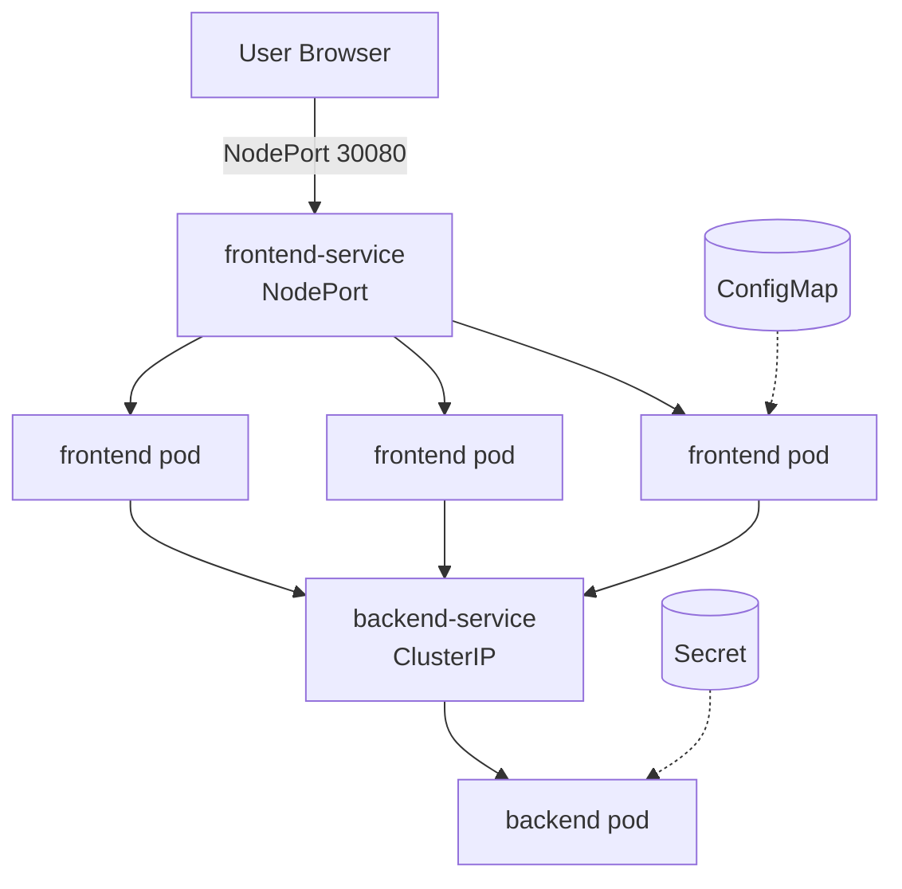
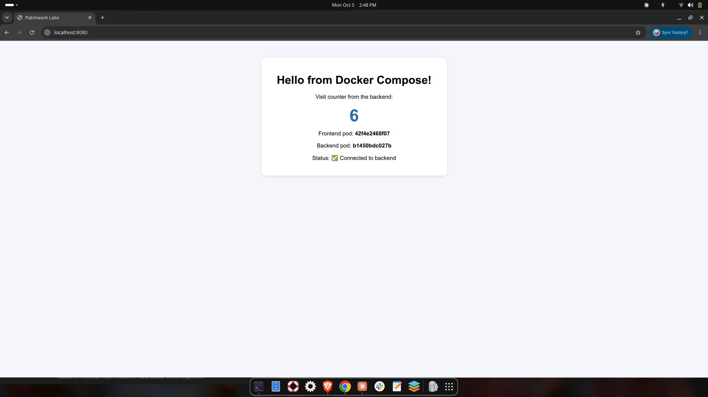
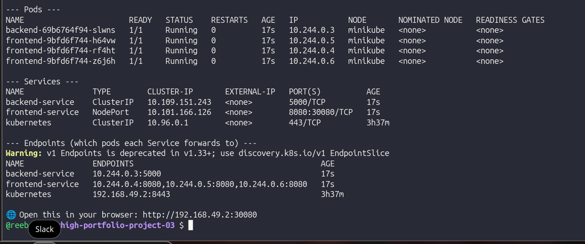
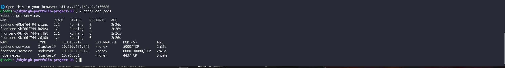
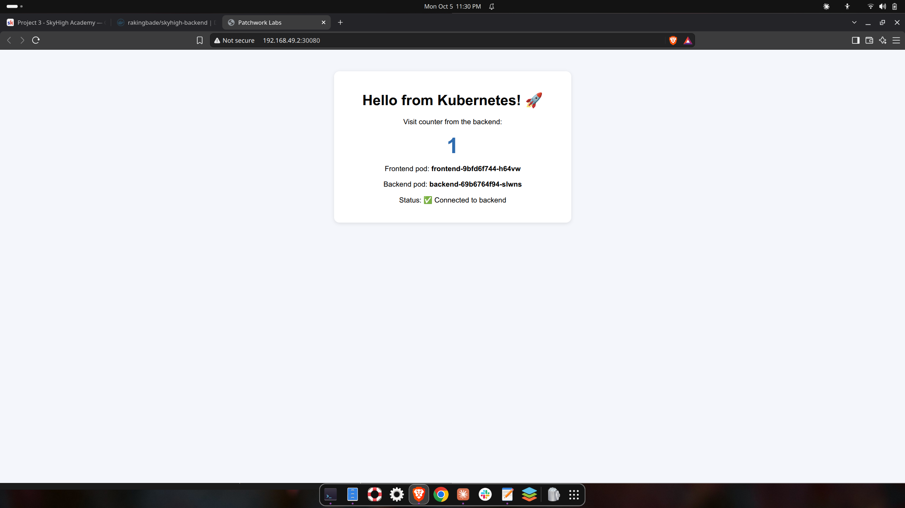
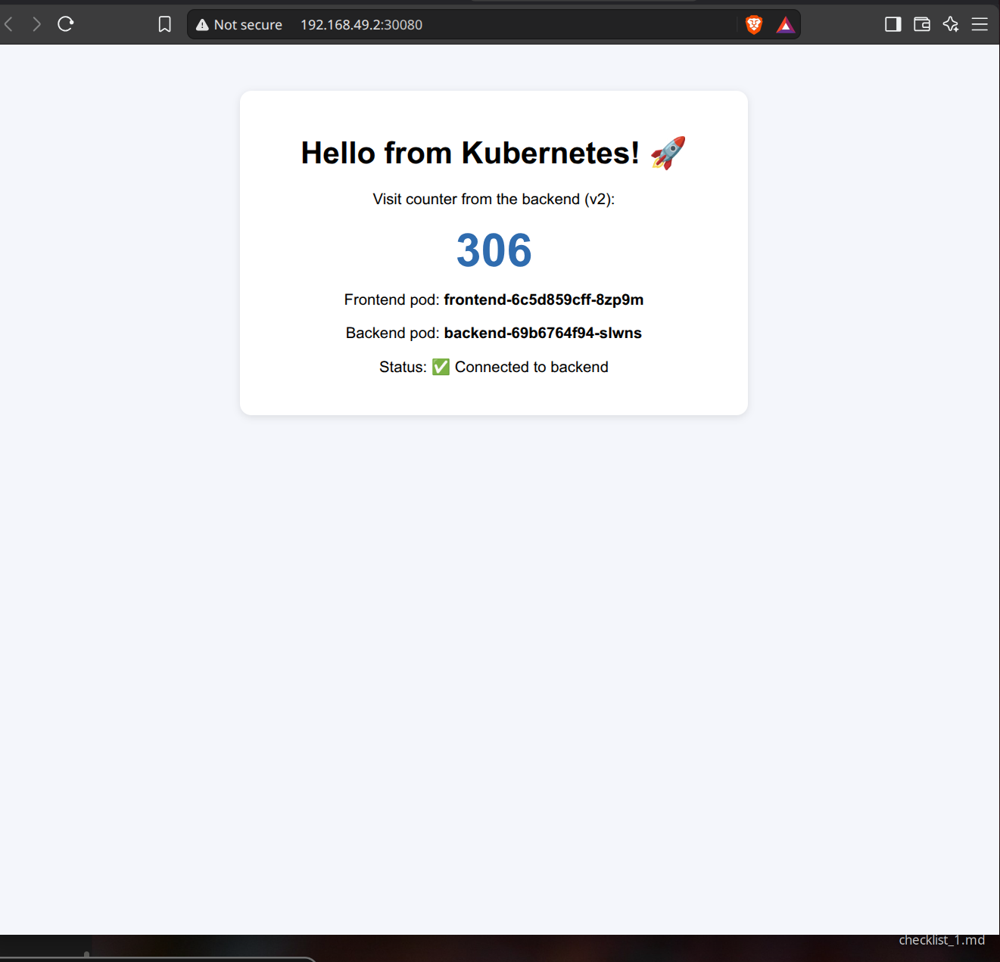
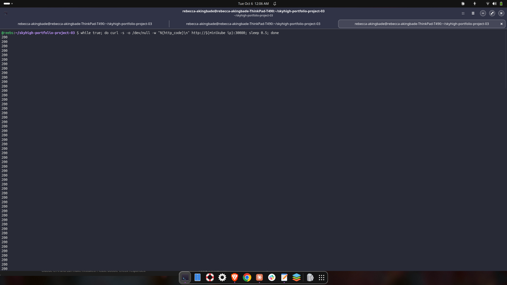

# Patchwork Labs: Two-Service App on Kubernetes

## 📋 Project Description

Patchwork Labs ran its entire product on a single EC2 instance, which meant downtime on every deployment and a single point of failure. I modernized it by containerizing a two-service app (a Flask frontend and a Flask backend API) with Docker, testing it locally with Docker Compose, pushing versioned images to Docker Hub, and deploying it to Kubernetes with horizontal scaling, health checks, and externalized configuration.

I then proved each goal: automatic recovery (deleted a pod and watched it get replaced), horizontal scaling (scaled from 3 to 5 replicas with one command), and zero-downtime deployments (rolled out v2 while sending continuous traffic, with every request returning HTTP 200).

## 🏗️ Architecture



- **Frontend:** 3 replicas, stateless, exposed through a NodePort Service.
- **Backend:** 1 replica (it holds an in-memory counter), reachable only inside the cluster through a ClusterIP Service.
- **ConfigMap** injects the backend URL and page message. **Secret** injects an API key.

## 🧰 Tech Stack

Python (Flask, Gunicorn) · Docker · Docker Compose · Docker Hub · Kubernetes (minikube) · kubectl · Bash · Ubuntu Linux

## 📁 Repository Structure

```
├── backend/            Flask API, Dockerfile, .dockerignore
├── frontend/           Flask web page, Dockerfile, .dockerignore
├── k8s/                ConfigMap, Secret, Deployments, Services
├── scripts/            Helper scripts (check tools, build/push, deploy, test, teardown)
├── screenshots/        Proof of each stage
└── docker-compose.yml  Local multi-container setup
```

## 💻 Run Locally (Docker Compose)

```bash
docker compose up --build
# Open http://localhost:8080
```

## ☸️ Run on Kubernetes (minikube)

```bash
minikube start --driver=docker --cpus=2 --memory=4096
./scripts/deploy.sh
# Open the URL the script prints, e.g. http://<minikube-ip>:30080
```

## 🐳 Images

- Frontend: https://hub.docker.com/r/rakingbade/skyhigh-frontend
- Backend: https://hub.docker.com/r/rakingbade/skyhigh-backend

Images use pinned version tags (`v1`, `v2`), never `latest`, so deployments are predictable and rollbacks are one command.

## 📸 Screenshots

**Docker Compose running locally**


**All pods Running**


**Services**


**Live frontend on Kubernetes with backend data**


**Rolling update to v2**


**Zero downtime: continuous requests returned HTTP 200 during the rollout**


## 🔐 Security Decisions

- Containers run as a **non-root user** (principle of least privilege).
- Small `python:3.11-slim` base images reduce size and attack surface.
- The backend is **ClusterIP only**, so it isn't exposed outside the cluster.
- Config lives outside the image (ConfigMap and Secret), following Twelve-Factor principles.
- The API returns whether the secret loaded (`true/false`), never the secret itself.
- The Secret in this repo is **fake**. Kubernetes Secrets are only base64 encoded, not encrypted, so in production I would use AWS Secrets Manager or Sealed Secrets and enable encryption at rest.
- Docker Hub login uses a **personal access token**, not an account password.

## 🧗 Challenges & Solutions

- **Docker "permission denied" on docker.sock.** My user wasn't active in the `docker` group yet. I verified with `groups` and `getent group docker`, then restarted so the group membership took effect.
- **Frontend build failed: "open Dockerfile: no such file or directory."** I read the error, listed the folder with `ls -la`, confirmed the Dockerfile was missing, and recreated it.
- **Config/Secret ordering.** `kubectl apply -f k8s/` applies files alphabetically, which would start the backend before its Secret existed. My deploy script applies the ConfigMap and Secret first.
- **`secret/backend-secret configured` on every apply.** Investigated and learned `stringData` is write-only and converted to `data`, so kubectl always sees a difference even when nothing changed.
- **Proving zero downtime.** The browser reuses connections, so I used a `curl` loop printing HTTP status codes during the rollout to prove every request succeeded.

## 🔮 What I'd Do Differently

- Package the manifests as a **Helm chart**.
- Replace NodePort with an **Ingress controller** and add HTTPS with TLS.
- Add a **Horizontal Pod Autoscaler** to scale the frontend on CPU load.
- Move the counter to **Redis** so the backend becomes stateless and can scale past 1 replica.
- Manage secrets with **AWS Secrets Manager** or **Sealed Secrets**.
- Add a **CI/CD pipeline** to build, tag, and deploy images automatically.
